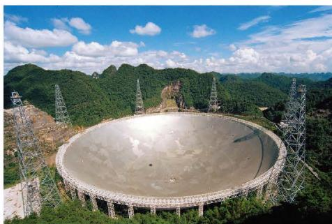

13. 如图, 我国自主研发的 $500 \mathrm{~m}$ 口径球面射电望远镜 (FAST) 有 “中国天眼” 之称, 它的反射面面积约为 $2.5 \times 10^{5} \mathrm{~m}^{2}$ ; 一个 11 人制正规足球场的面积约为 $7.14 \times 10^{3} \mathrm{~m}^{2}$ 。“中国天眼”的反射面面积大约相当于多少个 11 人制正规足球场的面积 (结果精确到 1 个)?

(第13题)

## 相关知识点

暂无已审核的相关知识点。

> 来源：北师大版初中数学·七年级下册
