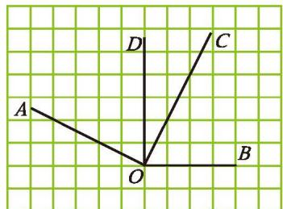

2. 下面是画在方格纸上的两个图形，请分别找出图中互相垂直的线段。

(1)

(第2题)

(2)

## 相关知识点

- [两条直线互相垂直、垂线与垂足的概念（范围关联）](../%E7%9F%A5%E8%AF%86%E7%82%B9/%E4%B8%A4%E6%9D%A1%E7%9B%B4%E7%BA%BF%E4%BA%92%E7%9B%B8%E5%9E%82%E7%9B%B4%E3%80%81%E5%9E%82%E7%BA%BF%E4%B8%8E%E5%9E%82%E8%B6%B3%E7%9A%84%E6%A6%82%E5%BF%B5.md)
- [垂线的唯一性、垂线段最短与点到直线的距离（范围关联）](../%E7%9F%A5%E8%AF%86%E7%82%B9/%E5%9E%82%E7%BA%BF%E7%9A%84%E5%94%AF%E4%B8%80%E6%80%A7%E3%80%81%E5%9E%82%E7%BA%BF%E6%AE%B5%E6%9C%80%E7%9F%AD%E4%B8%8E%E7%82%B9%E5%88%B0%E7%9B%B4%E7%BA%BF%E7%9A%84%E8%B7%9D%E7%A6%BB.md)

> 来源：北师大版初中数学·七年级下册
