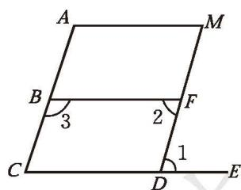

例1 根据图 2-30 回答下列问题:

(1) 若 $\angle 1 = \angle 2$ ，则可以判定哪两条直线平行？依据是什么？

(2) 若 $\angle 2 = \angle M$ ，则可以判定哪两条直线平行？依据是什么？

(3) 若 $\angle 2 + \angle 3 = 180^{\circ}$ , 则可以判定哪两条直线平行? 依据是什么?

图2-30

## 相关知识点

- [平行线的三条基本性质（范围关联）](../%E7%9F%A5%E8%AF%86%E7%82%B9/%E5%B9%B3%E8%A1%8C%E7%BA%BF%E7%9A%84%E4%B8%89%E6%9D%A1%E5%9F%BA%E6%9C%AC%E6%80%A7%E8%B4%A8.md)
- [阅读·思考：埃拉托色尼利用平行线内错角测地球周长（范围关联）](../%E7%9F%A5%E8%AF%86%E7%82%B9/%E9%98%85%E8%AF%BB%C2%B7%E6%80%9D%E8%80%83%EF%BC%9A%E5%9F%83%E6%8B%89%E6%89%98%E8%89%B2%E5%B0%BC%E5%88%A9%E7%94%A8%E5%B9%B3%E8%A1%8C%E7%BA%BF%E5%86%85%E9%94%99%E8%A7%92%E6%B5%8B%E5%9C%B0%E7%90%83%E5%91%A8%E9%95%BF.md)

> 来源：北师大版初中数学·七年级下册
