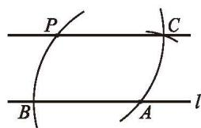

(第9题)

※9. 如图, 已知点 $P$ 在直线 $l$ 外, 利用如下方法也可以作出过点 $P$ 与直线 $l$ 平行的直线:

在直线 l 上任取一点 A，以点 A 为圆心，以 AP 的长为半径作弧，交直线 l 于点 B；以点 P 为圆心，以 PA 的长为半径作弧；以点 A 为圆心，以 PB 的长为半径作弧，交前弧于点 C；作直线 PC，则 $PC \parallel l$ 。

(1)这种作法用到了哪些你学过的基本尺规作图?(提示:连接 $PA$ )

(2) 如何说明这种作法的道理?

(3) 连接 $PB, AC$ , 在图中能发现你熟悉的图形吗?
