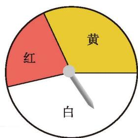

2. 右图是一个可以自由转动的转盘，转动转盘，当转盘停止时，指针落在哪个区域的可能性最大？请说明你的理由。

(第2题)

## 相关知识点

- [随机事件发生可能性的大小（范围关联）](../%E7%9F%A5%E8%AF%86%E7%82%B9/%E9%9A%8F%E6%9C%BA%E4%BA%8B%E4%BB%B6%E5%8F%91%E7%94%9F%E5%8F%AF%E8%83%BD%E6%80%A7%E7%9A%84%E5%A4%A7%E5%B0%8F.md)
- [必然事件、不可能事件与随机事件（范围关联）](../%E7%9F%A5%E8%AF%86%E7%82%B9/%E5%BF%85%E7%84%B6%E4%BA%8B%E4%BB%B6%E3%80%81%E4%B8%8D%E5%8F%AF%E8%83%BD%E4%BA%8B%E4%BB%B6%E4%B8%8E%E9%9A%8F%E6%9C%BA%E4%BA%8B%E4%BB%B6.md)

> 来源：北师大版初中数学·七年级下册
