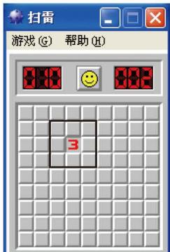

8. 如图, 此为计算机 “扫雷” 游戏的画面, 在 $9 \times 9$ 个小方格的 “雷区” 中, 随机埋藏着 10 颗 “地雷”, 每个小方格最多能埋藏 1 颗 “地雷”。小明游戏时先踩中一个小方格, 显示数字 3 , 它表示与这个方格相邻的 8 个小方格 (图中黑框所围区域, 设为 A 区域) 中埋藏着 3 颗 “地雷”。为了尽可能不踩中 “地雷”, 小明的第二步应踩在 A 区域内的小方格上还是应踩在 A 区域外的小方格上?

(第8题)
