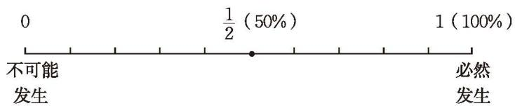
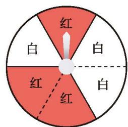

2. 请将下列事件发生的概率标在图中：

(第2题)

(1)当室外温度低于 $-10^{\circ} \mathrm{C}$ 时, 将一碗清水放在室外, 半小时后水会结冰;

(2) 任意掷两枚质地均匀的骰子，掷出的点数之和为1;

(3) 自由转动如图所示的转盘（转盘被等分成 6 个扇形），当它停止时，指针落在红色区域。

[第2（3）题]

## 相关知识点

暂无已审核的相关知识点。

> 来源：北师大版初中数学·七年级下册
