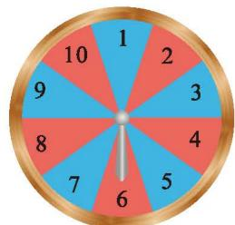

8. 如图所示, 一个可以自由转动的转盘被等分成 10 个扇形, 分别标有 $1, 2, 3, 4, 5, 6, 7, 8, 9, 10$ 这 10 个数字。转动转盘, 当转盘停止时, 指针指向的数字即为转出的数字。两人参与游戏: 一人转动转盘, 另一人猜数, 若所猜数字与转出的数字相符, 则猜数的人获胜, 否则转动转盘的人获胜。猜数的方法从下面三种中选一种:

(第8题)

(1) 猜 “是奇数” 或 “是偶数”;

(2) 猜 “是3的倍数” 或 “不是3的倍数”;

(3) 猜 “是大于6的数” 或 “不是大于6的数”。

如果轮到你猜数，那么为了尽可能获胜，你将选择哪一种猜数方法？怎样猜？
