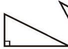
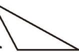
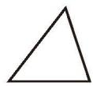
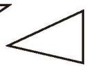
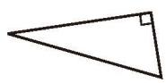
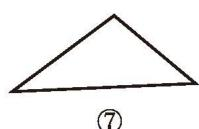

1. 观察下面的三角形，其中哪些是锐角三角形，哪些是直角三角形，哪些是钝角三角形？

②

⑥

(第1题)

## 相关知识点

- [三角形按内角大小分类及直角三角形的表示（范围关联）](../%E7%9F%A5%E8%AF%86%E7%82%B9/%E4%B8%89%E8%A7%92%E5%BD%A2%E6%8C%89%E5%86%85%E8%A7%92%E5%A4%A7%E5%B0%8F%E5%88%86%E7%B1%BB%E5%8F%8A%E7%9B%B4%E8%A7%92%E4%B8%89%E8%A7%92%E5%BD%A2%E7%9A%84%E8%A1%A8%E7%A4%BA.md)
- [直角三角形两锐角互余（范围关联）](../%E7%9F%A5%E8%AF%86%E7%82%B9/%E7%9B%B4%E8%A7%92%E4%B8%89%E8%A7%92%E5%BD%A2%E4%B8%A4%E9%94%90%E8%A7%92%E4%BA%92%E4%BD%99.md)
- [三角形内角和定理的探索与验证（范围关联）](../%E7%9F%A5%E8%AF%86%E7%82%B9/%E4%B8%89%E8%A7%92%E5%BD%A2%E5%86%85%E8%A7%92%E5%92%8C%E5%AE%9A%E7%90%86%E7%9A%84%E6%8E%A2%E7%B4%A2%E4%B8%8E%E9%AA%8C%E8%AF%81.md)
- [三角形的定义、基本元素与符号表示（范围关联）](../%E7%9F%A5%E8%AF%86%E7%82%B9/%E4%B8%89%E8%A7%92%E5%BD%A2%E7%9A%84%E5%AE%9A%E4%B9%89%E3%80%81%E5%9F%BA%E6%9C%AC%E5%85%83%E7%B4%A0%E4%B8%8E%E7%AC%A6%E5%8F%B7%E8%A1%A8%E7%A4%BA.md)

> 来源：北师大版初中数学·七年级下册
