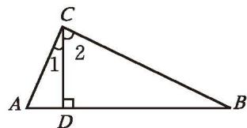

4. 如图, 已知 $\angle ACB = 90^{\circ}, CD \perp AB$ , 垂足是 $D$ 。

(1) 图中有几个直角三角形? 是哪几个? 分别说出它们的直角边和斜边。

(2) $\angle 1$ 和 $\angle A$ 有什么关系? $\angle 2$ 和 $\angle A$ 呢?

(第4题)

## 相关知识点

暂无已审核的相关知识点。

> 来源：北师大版初中数学·七年级下册
