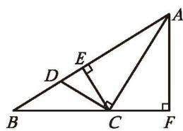

6. 如图, 在 $\triangle ABC$ 中, $BC$ 边上的高是 $\_\_\_{}$ , $AB$ 边上的高是 $\_\_\_{}$ ; 在 $\triangle BCE$ 中, $BE$ 边上的高是 $\_\_\_{}$ , $EC$ 边上的高是 $\_\_\_{}$ ; 在 $\triangle ACD$ 中, $AC$ 边上的高是 $\_\_\_{}$ , $CD$ 边上的高是 $\_\_\_{}$ .

$AB$ 边上的高 $BG$

(第6题)

## 相关知识点

暂无已审核的相关知识点。

> 来源：北师大版初中数学·七年级下册
