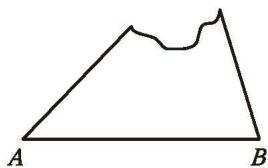

13. 一个缺角的三角形残片如图所示。

(1) 不恢复这个缺角, 你能画出 $AB$ 边上的高所在的直线吗? 你是如何画的? 依据是什么?

(2) 小明分别画出 $\angle A$ 和 $\angle B$ 的平分线, 两线交于点 $D$ , 又找到 $AB$ 边的中点 $E$ , 画直线 $DE$ , 小明说他画出了第三个角的角平分线所在的直线。你认为他说的对吗? 为什么?

(第13题)
