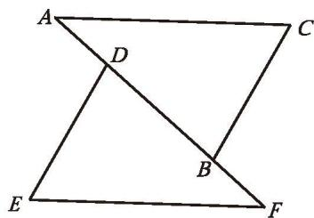

(第2题)

2. 如图, 已知 $\triangle ABC \cong \triangle FDE$ , $AD = 1 \mathrm{~cm}$ , $BD = 2 \mathrm{~cm}$ , $\angle A = 40^{\circ}$ , $\angle E = 62^{\circ}$ , 求 $FD$ 的长, 以及 $\angle C$ , $\angle FDE$ 的度数。
