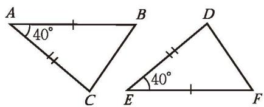
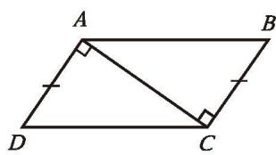

1. 分别找出各图中的全等三角形，并说明理由。

(1)

(第1题)
(2)

## 相关知识点

- [“边边角”（SSA）不一定全等的反例结论与图示（范围关联）](../%E7%9F%A5%E8%AF%86%E7%82%B9/%E2%80%9C%E8%BE%B9%E8%BE%B9%E8%A7%92%E2%80%9D%EF%BC%88SSA%EF%BC%89%E4%B8%8D%E4%B8%80%E5%AE%9A%E5%85%A8%E7%AD%89%E7%9A%84%E5%8F%8D%E4%BE%8B%E7%BB%93%E8%AE%BA%E4%B8%8E%E5%9B%BE%E7%A4%BA.md)
- [全等三角形判定条件四：“边角边”（SAS）（范围关联）](../%E7%9F%A5%E8%AF%86%E7%82%B9/%E5%85%A8%E7%AD%89%E4%B8%89%E8%A7%92%E5%BD%A2%E5%88%A4%E5%AE%9A%E6%9D%A1%E4%BB%B6%E5%9B%9B%EF%BC%9A%E2%80%9C%E8%BE%B9%E8%A7%92%E8%BE%B9%E2%80%9D%EF%BC%88SAS%EF%BC%89.md)
- [尺规作图：已知三角形的两边及其夹角作三角形（范围关联）](../%E7%9F%A5%E8%AF%86%E7%82%B9/%E5%B0%BA%E8%A7%84%E4%BD%9C%E5%9B%BE%EF%BC%9A%E5%B7%B2%E7%9F%A5%E4%B8%89%E8%A7%92%E5%BD%A2%E7%9A%84%E4%B8%A4%E8%BE%B9%E5%8F%8A%E5%85%B6%E5%A4%B9%E8%A7%92%E4%BD%9C%E4%B8%89%E8%A7%92%E5%BD%A2.md)

> 来源：北师大版初中数学·七年级下册
