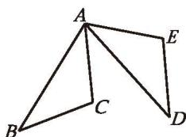

10. 如图, $AB = AD$ , $AC = AE$ , $\angle BAC = \angle DAE$ , $\angle B$ 与 $\angle D$ 相等吗? 小丽的思考过程如下。

(第10题)

在 $\triangle ABC$ 和 $\triangle ADE$ 中，
因为 $AB = AD, \angle BAC = \angle DAE, AC = AE,$ 所以 $\triangle ABC \cong \triangle ADE,$ 所以 $\angle B = \angle D$ 。

请说明小丽每一步的理由。

## 相关知识点

暂无已审核的相关知识点。

> 来源：北师大版初中数学·七年级下册
