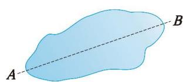

1. 如图, 一条输电线路需跨越一个池塘, 池塘两侧 $A$ , $B$ 处各立有一根电线杆, 但利用现有皮尺无法直接量出 $A$ , $B$ 间的距离。请你设计一个方案, 测出 $A$ , $B$ 间的距离, 并说明理由。

(第1题)

## 相关知识点

- [构造全等三角形测量不可直达距离的原理与模型（SAS 中心倍长模型）（范围关联）](../%E7%9F%A5%E8%AF%86%E7%82%B9/%E6%9E%84%E9%80%A0%E5%85%A8%E7%AD%89%E4%B8%89%E8%A7%92%E5%BD%A2%E6%B5%8B%E9%87%8F%E4%B8%8D%E5%8F%AF%E7%9B%B4%E8%BE%BE%E8%B7%9D%E7%A6%BB%E7%9A%84%E5%8E%9F%E7%90%86%E4%B8%8E%E6%A8%A1%E5%9E%8B%EF%BC%88SAS%20%E4%B8%AD%E5%BF%83%E5%80%8D%E9%95%BF%E6%A8%A1%E5%9E%8B%EF%BC%89.md)

> 来源：北师大版初中数学·七年级下册
