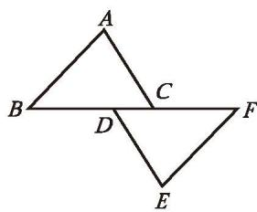

(第12题)

12. 如图， $\triangle ABC \cong \triangle EFD$ ，你能从图中找出几组平行线？小颖找出了一组平行线，她的思考过程如下。

因为 $\triangle ABC \cong \triangle EFD,$ 所以 $\angle ACB = \angle EDF$ 。
所以 $AC \parallel DE$ 。

请说明小颖每一步的理由。

## 相关知识点

暂无已审核的相关知识点。

> 来源：北师大版初中数学·七年级下册
