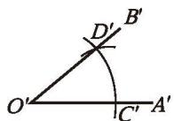

13. 你还记得怎样用尺规作一个角等于已知角吗？你能说明其中的道理吗？小明回顾了作图的过程，并进行了如下思考。

由尺规作图可知， $OC = O'C'$ ， $OD = O'D'$ ， $CD = C'D'$ ，所以 $\triangle OCD \cong \triangle O'C'D'$ 。所以 $\angle DOC = \angle D'O'C'$ 。

请说明小明每一步的理由。
