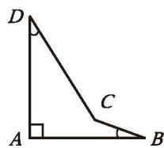

(第15题)

※15. 一个零件的形状如图所示, 按规定 $\angle A$ 应等于 $90^{\circ}, \angle B, \angle D$ 应分别等于 $20^{\circ}$ 和 $30^{\circ}$ 。李叔叔量得 $\angle BCD = 142^{\circ}$ , 就断定这个零件不合格。请说明其中的道理。

## 相关知识点

暂无已审核的相关知识点。

> 来源：北师大版初中数学·七年级下册
