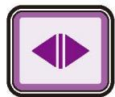
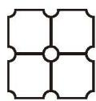

1. 下面的图形都是轴对称图形或成轴对称的图形，请分别找出它们的对称轴。

(第1题)

## 相关知识点

- [轴对称图形、对称轴与对应元素概念（范围关联）](../%E7%9F%A5%E8%AF%86%E7%82%B9/%E8%BD%B4%E5%AF%B9%E7%A7%B0%E5%9B%BE%E5%BD%A2%E3%80%81%E5%AF%B9%E7%A7%B0%E8%BD%B4%E4%B8%8E%E5%AF%B9%E5%BA%94%E5%85%83%E7%B4%A0%E6%A6%82%E5%BF%B5.md)
- [两个图形成轴对称的概念（范围关联）](../%E7%9F%A5%E8%AF%86%E7%82%B9/%E4%B8%A4%E4%B8%AA%E5%9B%BE%E5%BD%A2%E6%88%90%E8%BD%B4%E5%AF%B9%E7%A7%B0%E7%9A%84%E6%A6%82%E5%BF%B5.md)
- [轴对称的基本性质（范围关联）](../%E7%9F%A5%E8%AF%86%E7%82%B9/%E8%BD%B4%E5%AF%B9%E7%A7%B0%E7%9A%84%E5%9F%BA%E6%9C%AC%E6%80%A7%E8%B4%A8.md)

> 来源：北师大版初中数学·七年级下册
