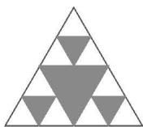

1. 下面是由大小不同的等边三角形组成的图案，请找出它的对称轴。

(第1题)

## 相关知识点

- [等腰三角形的轴对称性、“三线合一”与两底角相等（范围关联）](../%E7%9F%A5%E8%AF%86%E7%82%B9/%E7%AD%89%E8%85%B0%E4%B8%89%E8%A7%92%E5%BD%A2%E7%9A%84%E8%BD%B4%E5%AF%B9%E7%A7%B0%E6%80%A7%E3%80%81%E2%80%9C%E4%B8%89%E7%BA%BF%E5%90%88%E4%B8%80%E2%80%9D%E4%B8%8E%E4%B8%A4%E5%BA%95%E8%A7%92%E7%9B%B8%E7%AD%89.md)

> 来源：北师大版初中数学·七年级下册
