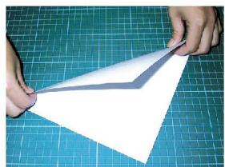
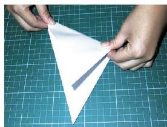
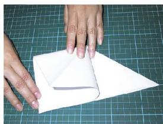
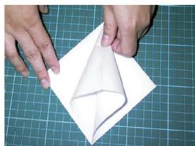
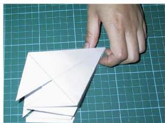
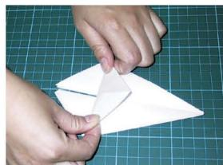
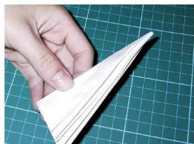
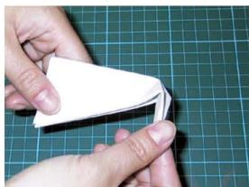
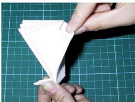
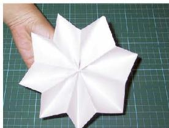

6. 按照下面的步骤，你会折出一朵漂亮的纸花。动手做一做。

(1) 将正方形对折;

(2) 再对折;

(3) 把得到的两个等腰直角三角形分别折成正方形；

(4) 将正方形的边隆起, 折成一个等腰三角形;

(5) 其他三边也重复同样的步骤；

(7) 折成直角；

(8) 将尾部向内折;

(9) 打开;

(10) 纸花做成了。

将纸花铺平，观察折痕中是否有线段的垂直平分线和角的平分线。分别有几条呢？
