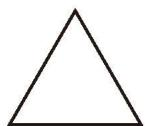
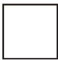
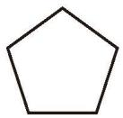
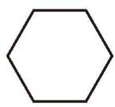
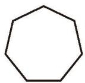

17. 试找出如图所示的每个正多边形对称轴的条数，并填入表格中。

(1)

(2)

(3)

(4)

(5)

(6)

(第17题)

<table><tr><td>正多边形的边数</td><td>3</td><td>4</td><td>5</td><td>6</td><td>7</td><td>8</td></tr><tr><td>对称轴的条数</td><td></td><td></td><td></td><td></td><td></td><td></td></tr></table>

根据上表，请就一个正 $n$ 边形对称轴的条数作一个猜想。
