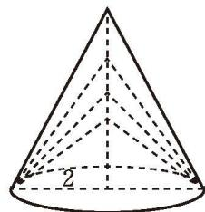

1. 如图, 圆锥的底面半径是 $2 \mathrm{~cm}$ , 当圆锥的高由小到大变化时, 圆锥的体积也随之发生了变化。

(1) 在这个变化过程中, 自变量、因变量各是什么?

(2) 如果圆锥的高为 $h$ (单位: $\mathrm{cm}$ ), 那么圆锥的体积 $V$ (单位: $\mathrm{cm}^{3}$ ) 如何表示?

(第1题)

(3) 当圆锥的高由 $1 \mathrm{~cm}$ 变化到 $10 \mathrm{~cm}$ 时, 它的体积是如何变化的?
