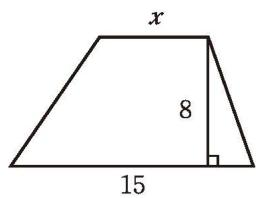

2. 如图，梯形上底的长是 $x \mathrm{~cm}$ ，下底的长是 $15 \mathrm{~cm}$ ，高是 $8 \mathrm{~cm}$ ，面积是 $y \mathrm{~cm}^{2}$ 。

(1) 写出 $y$ 与 $x$ 之间的关系式。

(2) 用表格表示当 $x$ 从 4 变到 14 时 (每次增加 1), $y$ 的相应值。

(第2题)

(3) 当 $x$ 每增加 1 时, $y$ 如何变化? 说说你的理由。

(4) 当 $x = 0$ 时, $y$ 等于什么? 此时它表示的是什么?
