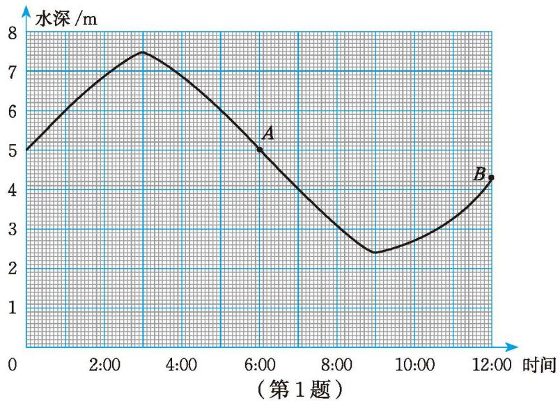

1. 海水受日月的引力而产生潮汐现象，早晨海水上涨称为潮，黄昏海水上涨称为汐，合称潮汐。潮汐与人类的生活有着密切的联系。下图呈现了某港口某天从0:00到12:00的水深情况。

观察图象，回答下列问题：

(1) 请描述这个港口这一天从 0:00 到 12:00 水深的变化情况。

(2) 什么时间港口的水最深, 深度约为多少? 什么时间港口的水最浅,深度约为多少?

(3) $A, B$ 两点分别表示什么？还有什么时间水的深度与 $A$ 点所表示的深度相同？

(4) 为保证安全, 港口规定: 只有当船底与港口水底之间的距离不少于 $2 \mathrm{~m}$ 时, 货轮才能进出港口。一艘货轮载货后吃水深 $4 \mathrm{~m}$ (即船底与水面之间的距离), 请你确定货轮可以进港的大致时间范围。
