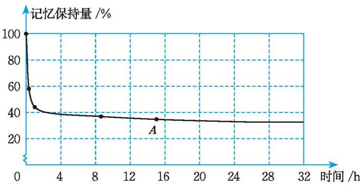

4. 如果不复习, 学习过的知识会随时间的推移而逐渐被遗忘。德国心理学家艾宾浩斯 (Hermann Ebbinghaus, 1850-1909) 最早研究了记忆遗忘规律。他根据自己得到的测试数据描绘了一条曲线 (如图所示), 这就是艾宾浩斯遗忘曲线。

(第4题)

观察图象，回答下列问题：

(1) 经过 $2 \mathrm{~h}$ , 记忆保持了多少?

(2)图中 $A$ 点表示什么？在哪个时间段内遗忘的速度最快？

(3) 有研究表明, 如及时复习, 经过一天记忆能保持 $98 \%$ 。根据遗忘曲线,如不复习, 结果又怎样? 由此, 你有什么感悟?
