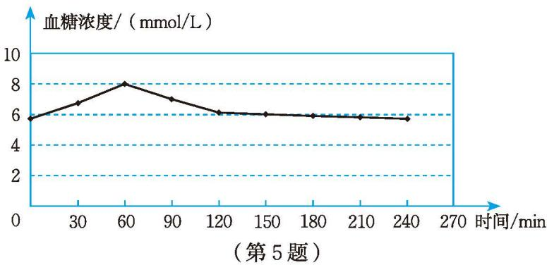

5. 下图统计了张明某次体检时口服葡萄糖溶液后每隔 $30 \mathrm{~min}$ 测得的血糖浓度 (单位: $\mathrm{mmol} / \mathrm{L}$ )。

观察图象，回答下列问题：

(1) 请描述张明这次体检口服葡萄糖溶液后 $240 \mathrm{~min}$ 内血糖浓度的变化情况。

(2)张明这次体检血糖浓度的最高值是多少,是何时达到的？最低值呢？

(3) 张明这次体检的血糖浓度在哪个时间段上升得比较快? 在哪个时间段下降得比较快?

