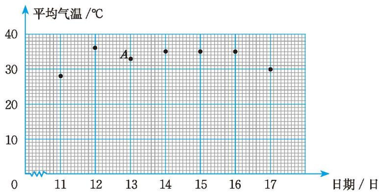

1. 某地电视台用下面的图象向观众描绘了该地某一星期的日平均气温变化情况。

(第1题)

观察图象，回答下列问题：

(1) 图象表示的是哪两个变量之间的关系？其中，哪个是自变量，哪个是因变量？

(2) 该地这一星期哪一天的日平均气温最低, 大约是多少? 哪一天的日平均气温最高, 大约是多少?

(B)

(3) 该地这一星期 14 日、15 日、16 日的日平均气温有什么关系？

(4)图中 $A$ 点表示哪一天的日平均气温？大约是多少？

(5) 说一说该地这一星期日平均气温是怎样变化的。
