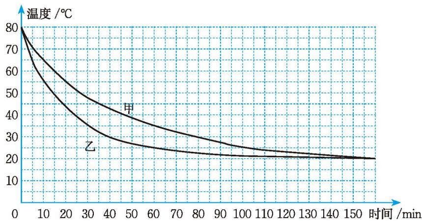

10. 为了检测甲、乙两个容器的保温性能, 检测员在两个容器中装满相同温度的水, 每隔 $5 \mathrm{~min}$ 测量一次两个容器中的水温 (实验过程中室温保持不变), 最后根据记录的温度画成了如图所示的图象。

(第10题)

观察图象，回答下列问题：

(1) 经过 $1 \mathrm{~h}$ , 哪个容器中的水温较高?

(2) 你估计检测员实验时的室温可能是多少?

(3) 你认为哪个容器的保温性能更好些？说说你的理由。
