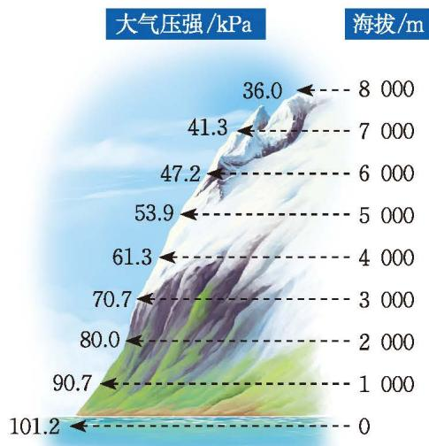

12. 下图呈现了大气压强与海拔之间的关系。

(第12题)

(1) 根据图中的数据填写下表。

<table><tr><td>海拔 /m</td><td>0</td><td>1 000</td><td>2 000</td><td>3 000</td><td>4 000</td><td>5 000</td><td>6 000</td><td>7 000</td><td>8 000</td></tr><tr><td>大气压强 /kPa</td><td></td><td></td><td></td><td></td><td></td><td></td><td></td><td></td><td></td></tr></table>

(2)随着海拔的变化,大气压强的变化趋势是怎样的？
