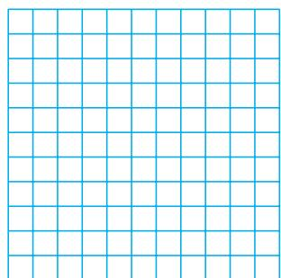
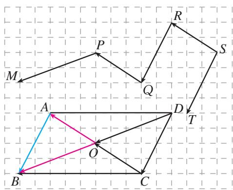

1. 在如图所示的坐标纸（规定小方格的边长为 1）中，用直尺和圆规画出下列向量：

(1) $|\overrightarrow{OA}| = 4$ ，点 $A$ 在点 $O$ 正南方向；

(2) $|\overrightarrow{OB}| = 2\sqrt{2}$ ，点 $B$ 在点 $O$ 北偏西 $45^{\circ}$ 方向；

(3) $|\overrightarrow{OC}| = 2$ ，点 $C$ 在点 $O$ 南偏西 $30^{\circ}$ 方向.

  
(第1题)

  
(第2题)
