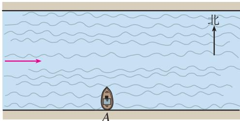

例 2 长江两岸之间没有大桥的地方，常常通过轮渡进行运输．如图 6.2-8，一艘船从长江南岸 A 地出发，垂直于对岸航行，航行速度的大小为 15 km/h，同时江水的速度为向东 6 km/h.

（1）用向量表示江水速度、船速以及船实际航行的速度；

  
图6.2-8

（2）求船实际航行的速度的大小（结果保留小数点后一位）与方向（用与江水速度间的夹角表示，精确到 $1^{\circ}$ ）.

