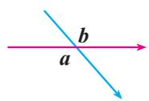
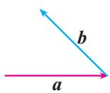
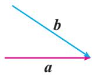
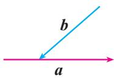

1. 如图，在下列各小题中，已知向量 a, b，分别用两种方法求作向量 $a + b$ .

(1)

(2)

(3)

(4)

(第1题)

## 相关知识点

- [平面向量的加法与运算律（范围关联）](../%E7%9F%A5%E8%AF%86%E7%82%B9/%E5%B9%B3%E9%9D%A2%E5%90%91%E9%87%8F%E7%9A%84%E5%8A%A0%E6%B3%95%E4%B8%8E%E8%BF%90%E7%AE%97%E5%BE%8B.md)

> 来源：高中必修 第二册·人教A版数学
