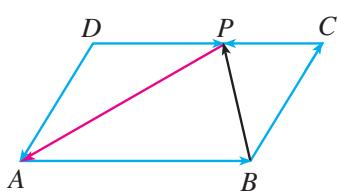

4. 如图，四边形 ABCD 是平行四边形，点 P 在 CD 上，判断下列各式是否正确（正确的在括号内打 “√”，错误的打 “×”）.

(1) $\overrightarrow{DA} +\overrightarrow{DP} = \overrightarrow{PA}$ （）

(2) $\overrightarrow{DA} +\overrightarrow{AB} +\overrightarrow{BP} = \overrightarrow{DP}.$ （）

(3) $\overrightarrow{AB} +\overrightarrow{BC} +\overrightarrow{CP} = \overrightarrow{PA}.$ （）

  
(第4题)
