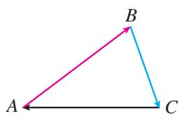
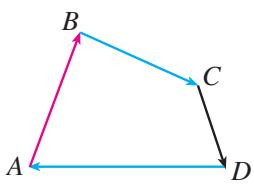
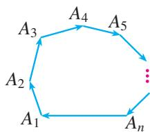

17.（1）如图（1），在 $\triangle ABC$ 中，计算 $\overrightarrow{AB} +\overrightarrow{BC} +\overrightarrow{CA}$

(2) 如图 (2)，在四边形 ABCD 中，计算 $\overrightarrow{AB} + \overrightarrow{BC} + \overrightarrow{CD} + \overrightarrow{DA}$ ;

（3）如图（3），在 n 边形 $A_{1}A_{2}A_{3}\cdots A_{n}$ 中， $\overrightarrow{A_{1}A_{2}}+\overrightarrow{A_{2}A_{3}}+\overrightarrow{A_{3}A_{4}}+\cdots+\overrightarrow{A_{n-1}A_{n}}+\overrightarrow{A_{n}A_{1}}=$ ？证明你的结论.

  
(1)

  
(2)  
(第 17 题)

  
(3)

## 相关知识点

暂无已审核的相关知识点。

> 来源：高中必修 第二册·人教A版数学
