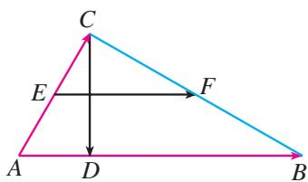

3. 如图，在 $\triangle ABC$ 中， $AD = \frac{1}{4} AB$ ，点 $E$ ， $F$ 分别是 $AC$ ， $BC$ 的中点。设 $\overrightarrow{AB} = a$ ， $\overrightarrow{AC} = b$ 。

(1) 用 a, b 表示 $\overrightarrow{CD}$ , $\overrightarrow{EF}$ .

(2) 如果 $\angle A = 60^{\circ}$ ，AB = 2AC，CD，EF 有什么关系？用向量方法证明你的结论.

(第3题)
