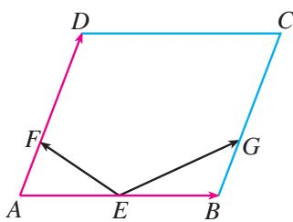

11. 如图，在平行四边形 ABCD 中，点 E 是 AB 的中点，点 F，G 分别是 AD，BC 的三等分点 $(AF=\frac{1}{3}AD, BG=\frac{1}{3}BC)$ . 设 $\overrightarrow{AB}=a, \overrightarrow{AD}=b$ ,
(1) 用 a, b 表示 $\overrightarrow{EF}, \overrightarrow{EG}$ .

（2）如果 $|\pmb{b}| = \frac{3}{2} |\pmb{a}|$ ， $EF$ ， $EG$ 有什么位置关系？用向量方法证明你的结论.

(第 11 题)
