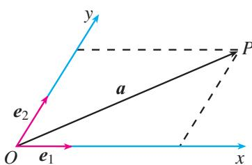

15. 如图，设 $Ox$ ， $Oy$ 是平面内相交成 $60^{\circ}$ 角的两条数轴， $\pmb{e}_1$ ， $\pmb{e}_2$ 分别是与 $x$ 轴、 $y$ 轴正方向同向的单位向量。若向量 $\overrightarrow{OP} = x\pmb{e}_1 + y\pmb{e}_2$ ，则把有序数对 $(x, y)$ 叫做向量 $\overrightarrow{OP}$ 在坐标系 $Oxy$ 中的坐标。设 $\overrightarrow{OP} = 3\pmb{e}_1 + 2\pmb{e}_2$

(1) 计算 $\left|\overrightarrow{OP}\right|$ 的大小;

(第 15 题)

(2) 根据平面向量基本定理判断, 本题中对向量坐标的规定是否合理.
