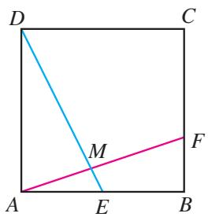
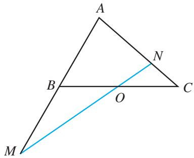

3. 如图，在 $\triangle ABC$ 中，点 $O$ 是 $BC$ 的中点，过点 $O$ 的直线分别交直线 $AB$ ， $AC$ 于不同的两点 $M$ ， $N$ . 设 $\overrightarrow{AB} = m\overrightarrow{AM}$ ， $\overrightarrow{AC} = n\overrightarrow{AN}$ ，求 $m + n$ 的值.

  
(第2题)

  
(第3题)

## 相关知识点

暂无已审核的相关知识点。

> 来源：高中必修 第二册·人教A版数学
