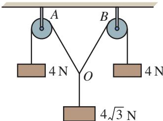

3. 若平面上的三个力 $F_{1}$ , $F_{2}$ , $F_{3}$ 作用于一点, 且处于平衡状态. 已知 $|\mathbf{F}_1| = 1 \mathrm{~N}$ , $|\mathbf{F}_2| = \frac{\sqrt{6} + \sqrt{2}}{2} \mathrm{~N}$ , $F_{1}$ 与 $F_{2}$ 的夹角为 $45^{\circ}$ , 求:

  
(第2题)

(1) $F_{3}$ 的大小;

(2) $F_{3}$ 与 $F_{1}$ 夹角的大小.
