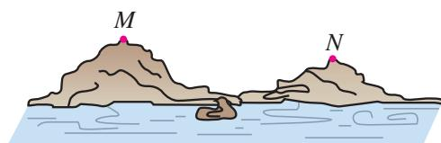

21. 如图，为了测量两山顶 $M, N$ 间的距离，飞机沿水平方向在 $A, B$ 两点进行测量， $A, B, M, N$ 在同一个铅垂平面内。请设计一个测量方案，包括：（1）指出要测量的数据（用字母表示，并标示在图中）；（2）用文字和公式写出计算 $M, N$ 间的距离的

A B

  
(第21题)

## 相关知识点

暂无已审核的相关知识点。

> 来源：高中必修 第二册·人教A版数学
