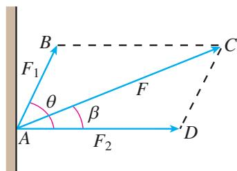

10. 如图，支座 $A$ 受 $\mathbf{F}_1$ ， $\mathbf{F}_2$ 两个力的作用，已知 $\mathbf{F}_1$ 与水平线成 $\theta$ 角， $|\mathbf{F}_1| = 40\mathrm{N}$ ， $\mathbf{F}_2$ 沿水平方向， $|\mathbf{F}_2| = 70\mathrm{N}$ ， $\mathbf{F}_1$ 与 $\mathbf{F}_2$ 的合力 $\mathbf{F}$ 的大小为 $100\mathrm{N}$ ，求 $\cos \theta$ 以及 $\mathbf{F}$ 与 $\mathbf{F}_2$ 的夹角 $\beta$ 的余弦值.

  
(第 10 题)

## 相关知识点

暂无已审核的相关知识点。

> 来源：高中必修 第二册·人教A版数学
