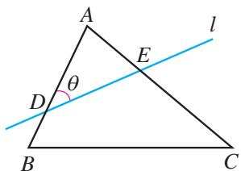

19. 如图，直线 $l$ 与 $\triangle ABC$ 的边 $AB$ ， $AC$ 分别相交于点 $D$ ， $E$ 。设 $AB = c$ ， $BC = a$ ， $CA = b$ ， $\angle ADE = \theta$ ，请用向量方法探究 $\theta$ 与 $\triangle ABC$ 的边和角之间的等量关系。

  
(第 19 题)

## 相关知识点

暂无已审核的相关知识点。

> 来源：高中必修 第二册·人教A版数学
