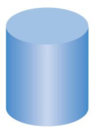
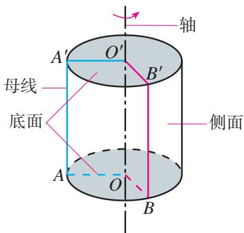

如图8.1-10，以矩形的一边所在直线为旋转轴，其余三边旋转一周形成的面所围成的旋转体叫做圆柱（circular cylinder）。旋转轴叫做圆柱的轴；垂直于轴的边旋转而成的圆面叫做圆柱的底面；平行于轴的边旋转而成的曲面叫做圆柱的侧面；无论旋转到什么位置，平行于轴的边都叫做圆柱侧面的母线。

  
图8.1-10

在生活中，许多物体和容器都是圆柱形的，如图 8.1-1 中的奶粉罐。圆柱用表示它的轴的字母表示，如图 8.1-10 中的圆柱记作圆柱 $O'O$ 。
