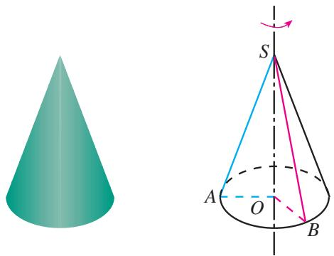

与圆柱一样，圆锥也可以看作由平面图形旋转而成的。如图8.1-11，以直角三角形的一条直角边所在直线为旋转轴，其余两边旋转一周形成的面所围成的旋转体叫做圆锥（circular cone）。图8.1-1中的铅锤就是圆锥形物体。圆锥也有轴、底面、侧面和母线。

  
图8.1-11

请你仿照圆柱中轴、底面、侧面、母线的定义，给出圆锥的轴、底面、侧面、母线的定义，并在图8.1-11中标出它们.

圆锥也用表示它的轴的字母表示，如图 8.1-11 中的圆锥记作圆锥 SO.
