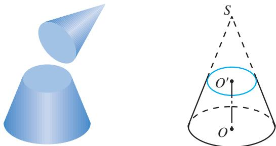

如图 8.1-12，与棱台类似，用平行于圆锥底面的平面去截圆锥，底面与截面之间的部分叫做圆台（circular truncated cone）。图 8.1-1 中的纸杯就是具有圆台结构特征的物体。

  
图8.1-12

与圆柱和圆锥一样，圆台也有轴、底面、侧面、母线（请你在图8.1-12中标出它们）。圆台也用表示它的轴的字母表示，如图8.1-12中的圆台记作圆台 $O^{\prime}O$ 。

探究

圆柱可以由矩形旋转得到，圆锥可以由直角三角形旋转得到。圆台是否也可以由平面图形旋转得到？如果可以，由什么平面图形旋转得到？如何旋转？

## 相关知识点

- [圆柱圆锥圆台与球的结构特征（范围关联）](../%E7%9F%A5%E8%AF%86%E7%82%B9/%E5%9C%86%E6%9F%B1%E5%9C%86%E9%94%A5%E5%9C%86%E5%8F%B0%E4%B8%8E%E7%90%83%E7%9A%84%E7%BB%93%E6%9E%84%E7%89%B9%E5%BE%81.md)
- [棱柱的结构特征（范围关联）](../%E7%9F%A5%E8%AF%86%E7%82%B9/%E6%A3%B1%E6%9F%B1%E7%9A%84%E7%BB%93%E6%9E%84%E7%89%B9%E5%BE%81.md)
- [基本立体图形（范围关联）](../%E7%9F%A5%E8%AF%86%E7%82%B9/%E5%9F%BA%E6%9C%AC%E7%AB%8B%E4%BD%93%E5%9B%BE%E5%BD%A2.md)
- [棱锥（范围关联）](../%E7%9F%A5%E8%AF%86%E7%82%B9/%E6%A3%B1%E9%94%A5.md)
- [棱台（范围关联）](../%E7%9F%A5%E8%AF%86%E7%82%B9/%E6%A3%B1%E5%8F%B0.md)

> 来源：高中必修 第二册·人教A版数学
