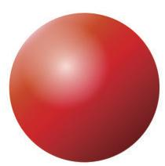
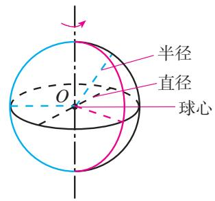

如图 8.1-13，半圆以它的直径所在直线为旋转轴，旋转一周形成的曲面叫做球面，球面所围成的旋转体叫做球体（spheroid），简称球．半圆的圆心叫做球的球心；连接球心和球面上任意一点的线段叫做球的半径；连接球面上两点并且经过球心的线段叫做球的直径. 球常用表示球心的字母来表示，如图 8.1-13 中的球记作球 O.

  
图8.1-13

棱柱、棱锥、棱台、圆柱、圆锥、圆台和球是常见的简单几何体。其中棱柱与圆柱统称为柱体，棱锥与圆锥统称为锥体，棱台与圆台统称为台体。

探究

棱柱、棱锥与棱台都是多面体，它们在结构上有哪些相同点和不同点？当底面发生变化时，它们能否互相转化？圆柱、圆锥与圆台呢？

## 相关知识点

- [圆柱圆锥圆台与球的结构特征（范围关联）](../%E7%9F%A5%E8%AF%86%E7%82%B9/%E5%9C%86%E6%9F%B1%E5%9C%86%E9%94%A5%E5%9C%86%E5%8F%B0%E4%B8%8E%E7%90%83%E7%9A%84%E7%BB%93%E6%9E%84%E7%89%B9%E5%BE%81.md)
- [棱柱的结构特征（范围关联）](../%E7%9F%A5%E8%AF%86%E7%82%B9/%E6%A3%B1%E6%9F%B1%E7%9A%84%E7%BB%93%E6%9E%84%E7%89%B9%E5%BE%81.md)
- [基本立体图形（范围关联）](../%E7%9F%A5%E8%AF%86%E7%82%B9/%E5%9F%BA%E6%9C%AC%E7%AB%8B%E4%BD%93%E5%9B%BE%E5%BD%A2.md)
- [棱锥（范围关联）](../%E7%9F%A5%E8%AF%86%E7%82%B9/%E6%A3%B1%E9%94%A5.md)
- [棱台（范围关联）](../%E7%9F%A5%E8%AF%86%E7%82%B9/%E6%A3%B1%E5%8F%B0.md)

> 来源：高中必修 第二册·人教A版数学
