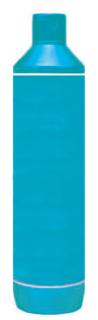
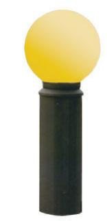
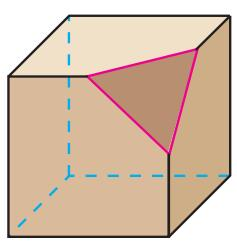
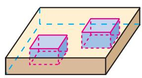
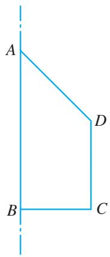
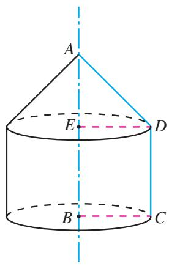

现实世界中的物体表示的几何体，除柱体、锥体、台体和球等简单几何体外，还有大量的几何体是由简单几何体组合而成的，这些几何体称作简单组合体.

  
(1)

  
(2)

  
(3)

  
(4)

图8.1-14

简单组合体的构成有两种基本形式：一种是由简单几何体拼接而成，如图8.1-14（1）（2）中物体表示的几何体；一种是由简单几何体截去或挖去一部分而成，如图8.1-14（3）（4）中的几何体。现实世界中的物体大多是由具有柱体、锥体、台体、球等结构特征的物体组合而成。

请你说一说图8.1-14中各几何体是由哪些简单几何体组合而成的.

例 2 如图 8.1-15（1），以直角梯形 ABCD 的下底 AB 所在直线为轴，其余三边旋转一周形成的面围成一个几何体．说出这个几何体的结构特征．

解：几何体如图8.1-15（2）所示，其中 $DE \perp AB$ ，垂足为 $E$ .

  
(1)

  
(2)

图8.1-15

这个几何体是由圆柱 BE 和圆锥 AE 组合而成的。其中圆柱 BE 的底面分别是 $\odot B$ 和 $\odot E$ ，侧面是由梯形的上底 CD 绕轴 AB 旋转形成的；圆锥 AE 的底面是 $\odot E$ ，侧面是由梯形的边 AD 绕轴 AB 旋转而成的。
