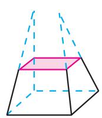
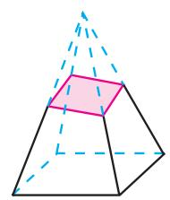

4. 如图，判断下列几何体是不是台体，并说明为什么.

  
(1)

  
(2)  
(第4题)

  
(3)

## 相关知识点

- [圆柱圆锥圆台与球的结构特征（范围关联）](../%E7%9F%A5%E8%AF%86%E7%82%B9/%E5%9C%86%E6%9F%B1%E5%9C%86%E9%94%A5%E5%9C%86%E5%8F%B0%E4%B8%8E%E7%90%83%E7%9A%84%E7%BB%93%E6%9E%84%E7%89%B9%E5%BE%81.md)
- [棱柱的结构特征（范围关联）](../%E7%9F%A5%E8%AF%86%E7%82%B9/%E6%A3%B1%E6%9F%B1%E7%9A%84%E7%BB%93%E6%9E%84%E7%89%B9%E5%BE%81.md)
- [基本立体图形（范围关联）](../%E7%9F%A5%E8%AF%86%E7%82%B9/%E5%9F%BA%E6%9C%AC%E7%AB%8B%E4%BD%93%E5%9B%BE%E5%BD%A2.md)
- [棱锥（范围关联）](../%E7%9F%A5%E8%AF%86%E7%82%B9/%E6%A3%B1%E9%94%A5.md)
- [棱台（范围关联）](../%E7%9F%A5%E8%AF%86%E7%82%B9/%E6%A3%B1%E5%8F%B0.md)

> 来源：高中必修 第二册·人教A版数学
